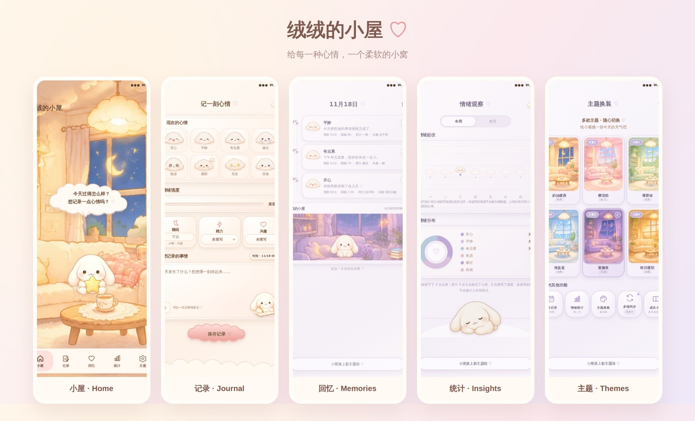
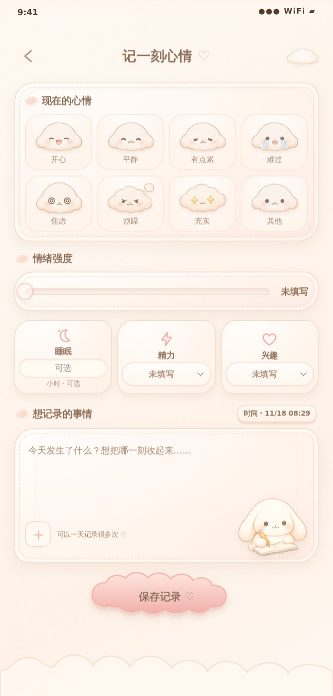
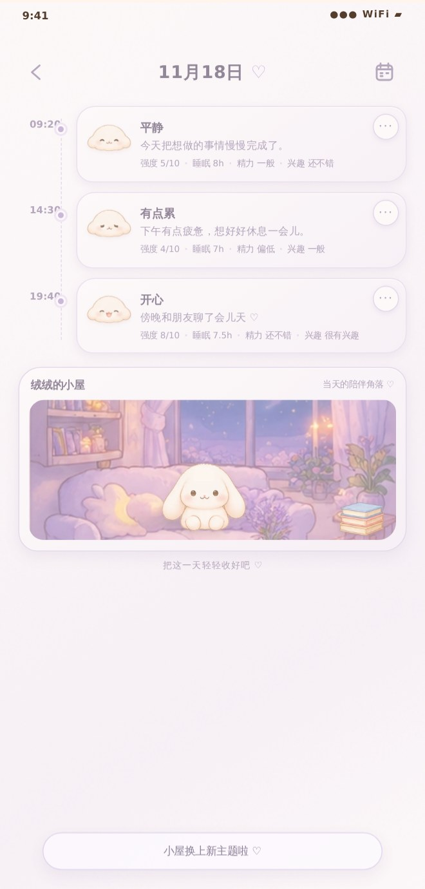
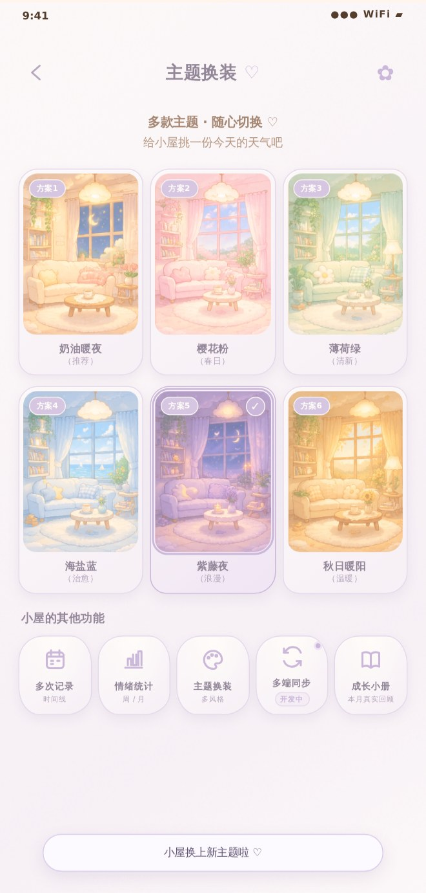

# 绒绒的小屋 · RONGRONG
### 给情绪一个柔软的落脚点 ♡

一个由小兔子陪伴的轻量情绪记录空间。把每天的心情、睡眠、精力与兴趣轻轻记下来，再回到自己的时间线上，看看那些真实发生过的瞬间。

**[在线体验 ↗](https://bdjmcncfjbdjnc-bit.github.io/rongrong/) · [查看源码](https://github.com/bdjmcncfjbdjnc-bit/rongrong) · [下载项目 ZIP](https://github.com/bdjmcncfjbdjnc-bit/rongrong/archive/refs/heads/main.zip)**

在线体验链接将在 GitHub Pages 首次部署成功后开放。

## 项目介绍

**绒绒的小屋** 是一个以「温柔记录，而不是评判自己」为出发点的情绪陪伴小应用。它不要求每天完成任务，也不把心情简单地归类成好或坏；你可以在一天中多次留下记录，再通过时间线回看情绪、睡眠、精力和兴趣的变化。

小兔子和不同主题的小屋，是记录之外的一点陪伴。希望它能成为一个可以随时回来坐一会儿的小角落。

## 核心功能

| 模块 | 功能 |
| --- | --- |
| 情绪记录 | 记录心情描述与 1–10 情绪强度；一天支持多次记录 |
| 状态观察 | 记录睡眠时长、精力与兴趣状态 |
| 情绪建议 | 根据所选心情提供建议值，仍可手动修改或清空 |
| 回忆时间线 | 按时间查看当天多条记录与状态摘要 |
| 小屋主题 | 六套房间主题，可全局切换 |
| 统计与回顾 | 查看记录趋势，帮助观察自己的变化 |
| 数据导出 | 支持 JSON / CSV 导出，方便自行备份 |

## 界面一览

上方拼图由项目浏览器自动截图工作流生成。每次展示用到的三条示例记录仅注入 CI 浏览器，不写入正式应用。主要界面：

- **回忆时间线：** 多条记录按时间排列，小屋场景作为下方的陪伴角落。
- **空状态回忆：** 没有记录的日期保留轻量提示，不插入虚构的情绪数据。
- **记录页选择器：** 精力与兴趣选项在页面内展开，不遮挡文字记录区域。

## 开始使用

### 在线体验

在线地址：<https://bdjmcncfjbdjnc-bit.github.io/rongrong/>

部署方式：仓库 **Settings → Pages → Build and deployment → Source** 选择 **GitHub Actions**；部署工作流位于 `.github/workflows/publish.yml`。首次发布成功后，上方地址即可使用。

### 本地运行（Windows）

1. 下载仓库 ZIP 并完整解压。
2. 保持 `index.html` 与 `assets.bundle.js` 在同一层。
3. 用 Chrome 直接打开 `index.html`；也可以在当前目录启动 `python -m http.server 8765`，再访问 `http://localhost:8765`。
4. `preview.html` 是页面预览入口，不会向正式数据写入示例情绪记录。

## 数据与隐私

- 当前版本使用浏览器 `localStorage` 保存记录，不需要登录，也没有连接云端数据库。
- 记录默认保存在当前浏览器和当前打开来源中；`file://` 与线上 / 本地 HTTP 地址的本地存储互不共享。
- 更换设备或切换打开方式前，请先导出 JSON 备份。
- GitHub Pages 仅托管静态网页，不会自动把浏览器本地记录同步到其他设备。

## 技术实现

| 技术 | 用途 |
| --- | --- |
| HTML / CSS | 页面结构、响应式布局与视觉主题 |
| 原生 JavaScript | 记录、时间线、主题、统计和交互逻辑 |
| SVG / PNG / WebP | 兔兔、装饰组件、图标与主题场景素材 |
| LocalStorage | 浏览器本地数据保存 |
| JSON / CSV | 数据备份与导出 |
| GitHub Pages | 静态网页托管 |

## v4.8 更新重点

- 有记录回忆页以时间线卡片为主，小屋场景缩小为辅助卡片。
- 指标摘要改为简洁文字，减少胶囊堆叠。
- 兔兔恢复完整不透明与正常混合模式，避免发灰和重影。
- 精力 / 兴趣改为页面流内嵌式选择面板，不再悬浮遮挡记录。
- 保留 v4.7 已确认的无记录空状态布局。
- 保留原有 `rongrong_records_v3` / `rongrong_theme_v3` 数据键与 JSON / CSV 结构。

## 测试记录

本轮功能回归报告记录：Chromium + Playwright 共 **44 项断言通过**，覆盖正式版与预览版启动、记录保存和编辑、多条时间线、六套主题、内嵌选择器、键盘操作及 360px / 390px 视口布局。测试报告与边界说明见 [docs/qa/](docs/qa/)；Windows 用户设备上的启动脚本仍建议首次运行时确认。

## 项目边界

这是一个持续迭代中的个人情绪记录原型，不提供医疗诊断或心理治疗，也不把情绪变化自动归因于某一种原因。项目当前没有账号系统、云端同步或服务端存储。所有演示截图中的示例记录均为离线截图环境专用，不会在正式版本中预设。

---

**今天也辛苦啦。想记录的时候，就来小屋坐一会儿。 ♡**

[回到项目主页](https://github.com/bdjmcncfjbdjnc-bit/rongrong)

